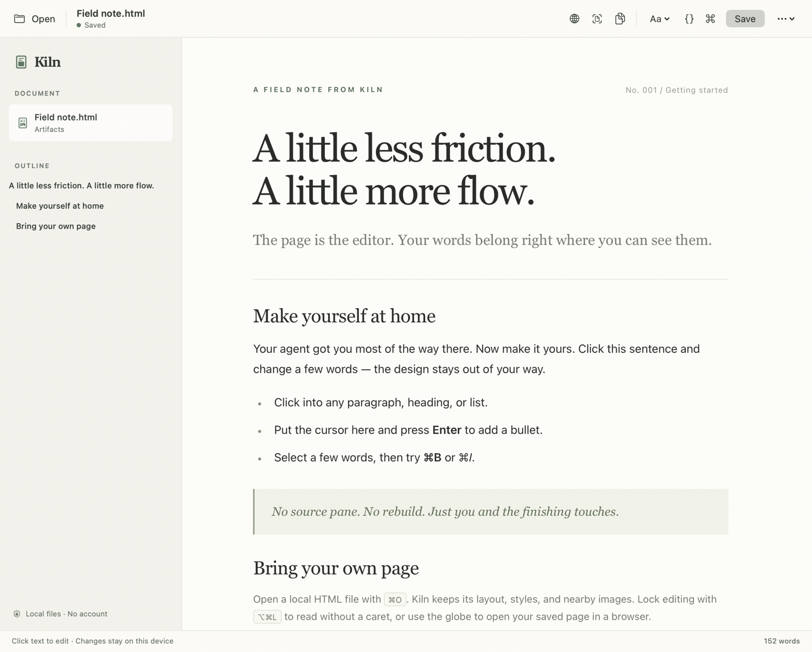
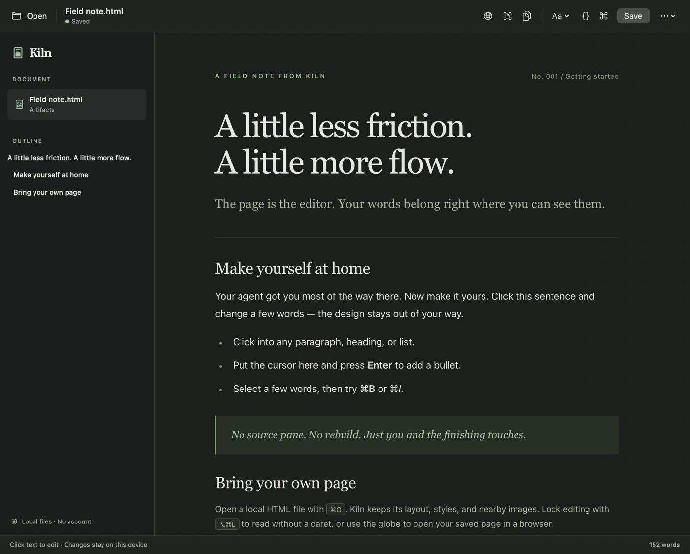

# Kiln

A small, local macOS editor for the last mile of an AI-generated HTML artifact.
Click the rendered words and type. The page is the editor, not a preview beside
one. Kiln leaves the document's design in place.



<details>
<summary>Dark mode</summary>



</details>

## Install

Requires macOS 14 or later and an Apple Silicon Mac. Download the early v0.3.0
release: [Kiln-0.3.0-macOS-arm64.zip](https://github.com/meagerfindings/kiln/releases/download/v0.3.0/Kiln-0.3.0-macOS-arm64.zip).
The release also includes [SHA256SUMS.txt](https://github.com/meagerfindings/kiln/releases/download/v0.3.0/SHA256SUMS.txt)
to verify the archive. This prebuilt is Apple Silicon only; Intel runtime
behavior has not been tested.

The v0.3.0 download predates Markdown typing shortcuts and spell-check. Build
from current `main` using the instructions below to try those features.

```sh
shasum -a 256 -c SHA256SUMS.txt
unzip Kiln-0.3.0-macOS-arm64.zip
mv Kiln.app /Applications/
open /Applications/Kiln.app
```

The app is ad-hoc signed, not Developer ID signed or notarized. If macOS blocks
the first launch, first try opening Kiln, then—only if you trust where you got
it—go to **System Settings > Privacy & Security > Open Anyway**. See Apple's
[supported instructions](https://support.apple.com/en-us/102445). Do not disable
Gatekeeper to launch the app.

## Build from source

Requires macOS 14 or later and Xcode Command Line Tools with Swift 5.9 or later.
No third-party packages, accounts, API keys, or web server are required. The
package builds for the current machine's architecture; Intel has not been
runtime-tested.

```sh
git clone https://github.com/meagerfindings/kiln.git
cd kiln
swift run Kiln
swift test
```

To create the packaged app bundle from source:

```sh
./scripts/build-app.sh
open dist/Kiln.app
```

## Use

- **Open** (`⌘O`) a `.html` or `.htm` file, or open one with Kiln in Finder.
- **Live Edit** lets you edit headings, paragraphs, list items, table cells, and
  text blocks in place. Press Enter in a list to continue it. Paste inserts plain
  text, not clipboard HTML.
- **Format** selected text with the toolbar menu. Undo and redo use WebKit's
  editing history and the native macOS undo stack. Headings apply to the current
  paragraph; list commands create a list, switch the current list's type, or
  remove it when invoked again.
- **Lock Editing** (`⌥⌘L`) lets you read without a caret, without a separate preview
  mode or reloading. It locks both the page and code. Use the View or more menu
  to lock; click the **Locked** indicator or use the shortcut to unlock.
- **Code** (`{}`) opens an optional inspector with syntax-colored HTML and CSS.
  CSS previews as you type, and the page remains editable alongside it.
  Choose an embedded stylesheet, or **New stylesheet**
  to add an override without rewriting the original styles. Linked CSS files
  are not edited. Emptying the new override removes it.
- **HTML** source offers native tag suggestions after `<` and `</`, or with
  Control-Space. It supports two-space Tab, indentation-preserving Enter, and
  native undo/redo. **Apply HTML** refreshes the preview; Save and closing the
  inspector also apply pending code. Applying HTML reloads the page and resets
  the page's undo history. The page is read-only while the **HTML** tab is open
  so a full source draft cannot overwrite concurrent visual edits.
- **Command palette** (`⌘P`) searches the available actions. Use the arrow keys
  and Return, or click a command. Escape dismisses it.
- **Spell-check** starts on for prose. Right-click an underlined word for native
  macOS suggestions. **Edit → Spelling and Grammar → Check Spelling While Typing**
  toggles checking and remembers your choice. Automatic spelling correction is
  disabled on the page; macOS text replacement starts off. Code blocks, inline
  code, and the HTML/CSS editors are excluded. Spelling hints never become part
  of your saved HTML.
- **Appearance** offers System, Light, and Dark in the View menu or toolbar's
  more menu. The app chrome and source editor adapt; imported pages keep their
  own colors. Pages with `prefers-color-scheme` styles, including the sample,
  respond to the chosen appearance. Kiln does not invert or rewrite your CSS.
- **Save** (`⌘S`) writes to the open file. **Save As** (`⇧⌘S`) creates a copy.
  There is no autosave. The built-in welcome page is a sample, not an original
  file that Save will overwrite.
- **Open in Browser** (`⌥⌘B`, globe button) asks for confirmation, saves the latest
  page and code edits, then opens that file in your default web browser. A failed
  or cancelled save never opens it. Unlike Kiln, the browser can run the file's
  scripts and fetch remote resources; only open HTML you trust.
- **Reveal in Finder** (`⌥⌘R`) selects the saved file so you can copy or move it.
  **Copy File Path** (`⌥⌘C`) copies its absolute path as plain text. Both have toolbar
  buttons and require a saved file; neither silently saves pending edits.

### Markdown typing shortcuts

Type Markdown directly on the editable page; Kiln turns the shortcut into HTML
without switching modes:

| Type | Result |
| --- | --- |
| `#` through `######`, then Space at the start of a paragraph or heading | Heading 1–6 |
| `**bold**` or `__bold__`, then Space | `<strong>bold</strong>` |
| `*italic*` or `_italic_`, then Space | `<em>italic</em>` |
| `-` or `*`, then Space at the start of a paragraph | Bulleted list |
| `1.`, then Space at the start of a paragraph | Numbered list |

Space confirms the shortcut and leaves subsequent typing outside the emphasis.
Immediately undo (`⌘Z`) to keep the literal Markdown instead; redo reapplies it.
Headings keep their existing attributes and content, and the HTML remains styled
by your document's CSS.

These are typing shortcuts, not a Markdown importer or a full CommonMark parser.
Existing document text, pasted Markdown, code blocks, and backslash-escaped
markers are not automatically converted. Inline shortcuts work within a single
plain-text run; nested or cross-element Markdown is not parsed. The HTML/CSS
source inspector stays a literal code editor.

### Keyboard shortcuts

| Action | Shortcut |
| --- | --- |
| Command palette | ⌘P |
| Bold / italic / underline / link | ⌘B / ⌘I / ⌘U / ⌘K |
| Heading 1 / 2 / 3 / paragraph | ⌥⌘1 / ⌥⌘2 / ⌥⌘3 / ⌥⌘0 |
| Bulleted / numbered list | ⇧⌘8 / ⇧⌘7 |
| Undo / redo | ⌘Z / ⇧⌘Z |
| Edit CSS / HTML | ⇧⌘E / ⇧⌘H |
| Return to the page | ⌥⌘E |
| HTML tag completion | ⌃Space |
| Lock / unlock editing | ⌥⌘L |
| Open in Browser | ⌥⌘B |
| Reveal in Finder | ⌥⌘R |
| Copy File Path | ⌥⌘C |

Formatting commands act on the live page selection; in source mode, you edit
the markup directly. The palette uses Obsidian's ⌘P rather than Print. Other
bindings follow familiar Mac document-editor conventions where practical.

## What this version is for

Static HTML artifacts: reports, briefs, proposals, documentation, and designed
pages. Native SwiftUI/AppKit supplies the window and file dialogs; WebKit renders
the original HTML/CSS and supplies editing and undo. Markdown typing shortcuts
produce ordinary HTML; there is no intermediate Markdown document or
editor-specific file format.

Artifact JavaScript never runs inside Kiln. Remote resources are blocked,
including CDN stylesheets, fonts, images, and scripts. Inline styles and relative
assets in the opened file's directory work offline. This means an interactive
React app, JavaScript-rendered chart, or Tailwind CDN artifact may not render as
intended. Export it as self-contained static HTML first.

Saving preserves the DOM, styles, metadata, relative URLs, and inert script
elements, but edited files are serialized by WebKit: source whitespace, entity
spelling, quote style, and malformed markup can normalize. An unchanged file
retains its original bytes. The source inspector changes HTML/CSS directly, but
this is not a byte-preserving source editor, full IDE, or drag-and-drop page builder.

UTF-8 files are supported. Keep nearby assets beside the HTML: Save As does not
copy assets or rewrite relative URLs, so moving just the HTML to another folder
can break those references. If another program changes an open file, Save refuses
to overwrite it; Save As lets you preserve your edits separately.

Scripts stay in exported HTML and can run when that file is opened in another
browser. Kiln's offline editing mode is not an HTML sanitization service.

## Source layout

- `Sources/Kiln/`: native window, document lifecycle, and WebKit bridge.
- `Sources/Kiln/Resources/editor.js`: isolated-world editing and clean export.
- `Sources/Kiln/Resources/Welcome.html`: an editable starter document.
- `Tests/KilnTests/`: regression tests against real macOS WebKit.
- `scripts/build-app.sh`: release build, icon, app bundle, and ad-hoc signing.

Run tests on macOS with an available WindowServer session; WebKit is not a
DOM mock. Test coverage and any current verification limitations are reported
with the delivered build, rather than inferred from compilation.
